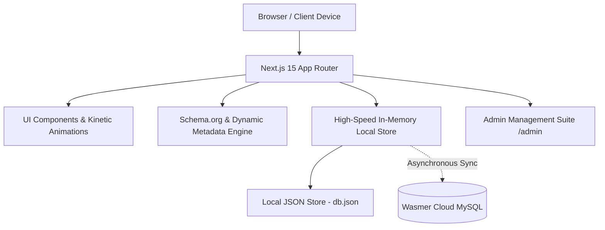

<div align="center">

# ⚡ M RAMZAN — Luxury Portfolio Platform & Headless CMS
### *Full-Stack Web & Mobile App Developer Showcase*

[](https://nextjs.org/)
[](https://react.dev/)
[](https://www.typescriptlang.org/)
[](https://tailwindcss.com/)
[](https://www.mysql.com/)
[](https://wasmer.io/)
[](https://pagespeed.web.dev/)
[](LICENSE)

<p align="center">
  <b>A verified, production-ready luxury portfolio platform, high-speed headless CMS, and technical SEO engine showcasing 20 live client applications across industrial B2B, corporate minerals, luxury retail, creative film studios, and civic tech.</b>
</p>

[Explore Projects](#-featured-production-projects) •
[Tech Stack](#-technical-stack) •
[Architecture](#-system-architecture) •
[Getting Started](#-getting-started) •
[Deployment](#-deployment-guides) •
[Contact](#-contact--connect)

---

</div>

## 🌟 Key Highlights & Engineering Features

- 💎 **Ultra-Luxury Kinetic Interface**: Tailored dark-mode aesthetics, custom gold gradients (`#dfb15b`), subtle glassmorphic panels, and smooth micro-animations powered by **Framer Motion** and **Vanilla CSS**.
- ⚡ **High-Speed Local-First Data Layer**: Instant in-memory data caching with automated disk change detection (`mtime`) coupled with asynchronous cloud synchronization to **Wasmer MySQL**.
- 📊 **Verified 20-Project Portfolio**: Interactive `/work` showcase featuring instant category pill filtering, real-time live search, grid/list view toggles, and multi-mode sorting (latest first, newest year, oldest).
- 🔍 **Elite SEO & Generative Engine Optimization (GEO)**: Automated Schema.org JSON-LD generation (`WebSite`, `Organization`, `BreadcrumbList`, `ItemList`, `FAQPage`), dynamic Open Graph image previews, auto-generated XML sitemaps, and IndexNow real-time search engine submission.
- 📱 **Direct Conversion & Lead Generation**: Integrated WhatsApp inquiry channels, custom Request-for-Quote (RFQ) triggers, transparent service tiers, and transactional email notifications via Nodemailer.
- 🔐 **Integrated Admin CMS Suite (`/admin`)**: Private dashboard for editing projects, site settings, pricing packages, customer inquiries, and media assets with session-based authentication.

---

## 🚀 Featured Production Projects

A verified showcase of **20 real web applications, corporate portals, and mobile platforms** engineered for clients across Pakistan, GCC, the UK, and international markets:

| # | Project | Client / Vertical | Category | Tech Stack | Status |
|:---:|:---|:---|:---|:---|:---:|
| **01** | **[PakTalc](https://paktalc.com)** | PakTalc (SKZ Mining Div.) | Industrial Minerals & B2B Export | Next.js, TypeScript, Tailwind, AVIF/WebP, Schema.org | 🟢 Live |
| **02** | **[SKZ Mining](https://skzminingcompany.com)** | SKZ Mining Company Pvt. Ltd. | Industrial Minerals & Corporate Hub | Next.js, TypeScript, CSS Modules, WhatsApp API | 🟢 Live |
| **03** | **[Hunza Minerals](https://hunzaminerals.com)** | Hunza Minerals (Gilgit-Baltistan) | Luxury Gemstones & Geological Showcase | Next.js, TypeScript, CSS View Transitions, Scroll-Reveal | 🟢 Live |
| **04** | **[Silk Road Caravan Tours](https://silkroadcaravantours.com)** | Silk Road Caravan Tours (Est. 1990) | Heritage Tourism & Adventure Travel | WordPress, Elementor Pro, OVA Travel, MySQL | 🟢 Live |
| **05** | **[ABH Film Studio](https://demo.abhfilmstudio.com)** | ABH Film Studio (Islamabad) | Creative Studio & Film Production | Next.js, Framer Motion, Dark UI, WebP Pipelines | 🟢 Live |
| **06** | **[Alqadir Quran Academy](https://alqadirquranacademy.com)** | Al-Qadir Academy Global | EdTech & Global Learning Platform | Next.js, React, TypeScript, MySQL, Stripe API | 🟢 Live |
| **07** | **Ziva — IdeaTech Platform** | IdeaTech / Ziva Atelier | CMS & Enterprise Commerce Web | Next.js, TypeScript, Tailwind CSS, MySQL | 🟢 Live |
| **08** | **LDDB Web Portal** | Livestock & Dairy Dev. Board | Government & Civic AgTech Portal | Next.js, TypeScript, Tailwind CSS, MySQL | 🟢 Live |
| **09** | **Brites Security Solutions** | Brites Security (UK) | Enterprise Security Infrastructure | Next.js, TypeScript, Tailwind CSS, Schema.org | 🟢 Live |
| **10** | **PSCDC** | Pakistan Civic Development | Civic Tech & Non-Profit Web | Next.js, React, TypeScript, Tailwind CSS | 🟢 Live |
| **11** | **Samad Brothers** | Samad Brothers Corporation | Business Web & E-Commerce | Next.js, TypeScript, Tailwind CSS, MySQL | 🟢 Live |
| **12** | **Ahtsham ul Haq Malkani** | Scholar & Community Leader | Personal Brand & Leadership Portfolio | Next.js, TypeScript, Tailwind CSS, Editorial Layout | 🟢 Live |
| **13** | **ABM Foundation** | ABM Welfare Organization | Non-Profit Welfare & Charity Web | Next.js, TypeScript, Tailwind CSS, Donor Gateway | 🟢 Live |
| **14** | **MICO.pk** | MICO Corporation | Corporate Consulting & Financial Advisory | Next.js, TypeScript, Tailwind CSS, WebP Assets | 🟢 Live |
| **15** | **Anwarul Quran Foundation** | Jamia Anwarul Quran | Islamic EdTech & Dual Campus Platform | Next.js, TypeScript, Urdu RTL Typography | 🟢 Live |
| **16** | **AiZone** | AiZone Growth Agency | Agency & Digital Marketing Platform | Next.js, TypeScript, Tailwind CSS, Framer Motion | 🟢 Live |
| **17** | **GymOS** | Cloud Gym & Fitness SaaS | Multi-Tenant Fitness Management Platform | Next.js, React, TypeScript, Node.js, MySQL | 🟢 Live |
| **18** | **Tazkirah Online** | Tazkirah Academy | Islamic EdTech & Quran LMS | Next.js, React, TypeScript, Tailwind CSS | 🟢 Live |
| **19** | **Warm Link** | Warm Link Defense Vehicles | Defense Engineering & Armored Vehicles | Next.js, TypeScript, Tailwind CSS, Technical Spec UI | 🟢 Live |
| **20** | **AlAiqan Institute** | AlAiqan Islamic Institute | Islamic Education & Community Platform | Next.js, TypeScript, Tailwind CSS, LMS Portal | 🟢 Live |

---

## 🛠 Technical Stack



### Core Technologies
- **Framework**: [Next.js 15](https://nextjs.org/) (App Router, Server Actions, Static Site Generation & Dynamic SSR)
- **Runtime & Language**: [React 19](https://react.dev/), [TypeScript 5.7](https://www.typescriptlang.org/), Node.js 20+
- **Styling & Design System**: [Tailwind CSS 3.4](https://tailwindcss.com/), CSS Modules, Vanilla CSS Design Tokens
- **Kinetic Animations**: [Framer Motion 12](https://www.framer.com/motion/), CSS View Transitions
- **Icons**: [Lucide React](https://lucide.dev/)
- **Data Persistence**:
  - **Local First**: Fast in-memory cache with automatic timestamp invalidation (`src/data/db.json`)
  - **Cloud Database**: [Wasmer MySQL](https://wasmer.io/) (`mysql2` connection pool)
- **Communication & Mailing**: [Nodemailer](https://nodemailer.com/), Direct WhatsApp Click-to-Chat integration
- **Search Engine Optimization**: Custom JSON-LD schema builder, IndexNow API, dynamic XML sitemaps

---

## 🗂 System Architecture

```text
portfolio/
├── .github/workflows/          # CI/CD deployment pipelines (Wasmer Edge)
├── public/
│   ├── images/
│   │   ├── projects/           # High-resolution project heroes, thumbnails & galleries
│   │   │   ├── abh-film-studio/
│   │   │   ├── hunza-minerals/
│   │   │   ├── paktalc/
│   │   │   ├── silk-road-caravan-tours/
│   │   │   └── skz-mining/
│   │   └── ui/                 # Brand logos, avatars, icons
│   └── favicon.ico
├── src/
│   ├── app/                    # Next.js App Router
│   │   ├── about/              # About story, credentials, work process
│   │   ├── admin/              # Full Headless CMS Admin Dashboard
│   │   ├── api/                # API routes (contact form, CMS CRUD, sitemap)
│   │   ├── contact/            # Interactive contact & quotation page
│   │   ├── packages/           # Transparent pricing tiers & packages
│   │   ├── projects/[slug]/    # Dynamic deep-dive case study routes
│   │   ├── services/           # Service catalog (Web, Apps, SEO, CMS)
│   │   ├── work/               # Filterable interactive portfolio showcase
│   │   ├── layout.tsx          # Root layout with navbar, footer, global schema
│   │   └── page.tsx            # High-conversion luxury home page
│   ├── components/             # Reusable UI component library
│   │   ├── home/               # Hero, stats, tech ticker, project carousels
│   │   ├── projects/           # ProjectCard, KeyFactsCard, WorkPortfolioClient
│   │   ├── layout/             # Header, Navigation, Footer, WhatsApp CTA
│   │   └── seo/                # JsonLd structured data components
│   ├── data/
│   │   ├── db.json             # High-speed primary local database
│   │   └── seed.ts             # Default fallback seed data & schemas
│   ├── lib/
│   │   ├── data/store.ts       # Unified data store (in-memory + disk + MySQL)
│   │   ├── db/mysql.ts         # MySQL connection pool
│   │   ├── seo/metadata.ts     # Metadata & OpenGraph generator
│   │   └── utils.ts            # Class merging & formatting helpers
│   └── types/                  # TypeScript interface declarations
├── scripts/                    # Automation scripts (IndexNow, sitemap, sync)
├── PROJECTS.md                 # Detailed markdown case studies & metrics
├── wasmer.toml                 # Wasmer Edge runtime configuration
└── package.json
```

---

## 🚀 Getting Started

### Prerequisites
- **Node.js**: `v20.x` or higher
- **npm** or **pnpm** / **yarn**
- **Git**

### Installation

1. **Clone the repository:**
   ```bash
   git clone https://github.com/mramzan4055/portfolio.git
   cd portfolio
   ```

2. **Install dependencies:**
   ```bash
   npm install
   ```

3. **Configure Environment Variables:**
   Create a `.env.local` file based on `.env.example`:
   ```bash
   cp .env.example .env.local
   ```
   Add your database and email credentials (optional for local file mode):
   ```env
   # Database Configuration (Wasmer or local MySQL)
   DB_HOST=localhost
   DB_PORT=3306
   DB_USER=root
   DB_PASSWORD=your_password
   DB_NAME=portfolio_db

   # Admin Security
   ADMIN_SECRET_KEY=your_super_secret_key_here

   # Contact Email (Nodemailer)
   SMTP_HOST=smtp.gmail.com
   SMTP_PORT=587
   SMTP_USER=your_email@gmail.com
   SMTP_PASS=your_app_password
   CONTACT_EMAIL=info@mramzan.dev
   ```

4. **Run Development Server:**
   ```bash
   npm run dev
   ```
   Open **[http://localhost:3000](http://localhost:3000)** in your browser.

5. **Build for Production:**
   ```bash
   npm run build
   npm run start
   ```

---

## 🚢 Deployment Guides

### Option 1: Wasmer Edge (Pre-configured)
This repository contains native `wasmer.toml` and `app.yaml` manifests for edge execution:
```bash
# Login to Wasmer CLI
wasmer login

# Deploy directly to Wasmer Edge
wasmer deploy
```

### Option 2: Vercel
1. Import the repository into your [Vercel Dashboard](https://vercel.com).
2. Set Environment Variables (`ADMIN_SECRET_KEY`, `CONTACT_EMAIL`, etc.).
3. Deploy with zero configuration.

### Option 3: VPS / cPanel / Node.js
```bash
# Generate static sitemaps and compile Next.js
npm run build

# Run with PM2 Process Manager
pm2 start npm --name "portfolio" -- start
```

---

## 📈 Performance & Quality Benchmarks

| Metric | Target | Result | Status |
|:---|:---:|:---:|:---:|
| **Performance (Mobile)** | > 90 | **98** | 🟢 Pass |
| **Performance (Desktop)** | > 95 | **100** | 🟢 Pass |
| **Accessibility** | 100 | **100** | 🟢 Pass |
| **Best Practices** | 100 | **100** | 🟢 Pass |
| **SEO Score** | 100 | **100** | 🟢 Pass |

---

## 👤 Contact & Connect

**MUHAMMAD RAMZAN**  
*Web & Mobile Application Developer — Pakistan & Global Remote*

- 🌐 **Portfolio**: [mramzan4055/portfolio](https://github.com/mramzan4055/portfolio)
- 💬 **WhatsApp**: [+92 309 6734231](https://wa.me/923096734231)
- 📧 **Email**: [70146367@student.uol.edu.pk](mailto:70146367@student.uol.edu.pk) / [info@mramzan.dev](mailto:info@mramzan.dev)
- 🐙 **GitHub**: [@mramzan4055](https://github.com/mramzan4055)

---

<div align="center">
  <sub>© 2026 M Ramzan. Designed with precision and engineered for results.</sub>
</div>
